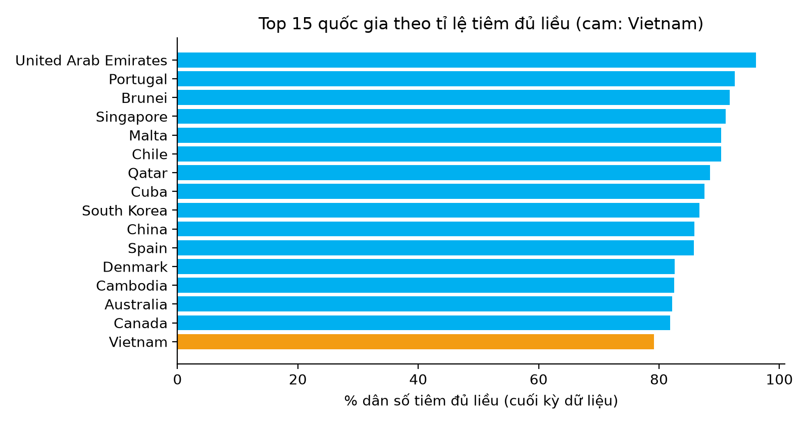

# Mini-project: AI + Python sinh báo cáo khoa học từ dữ liệu tiêm chủng COVID-19

Học phần **Công nghệ số nâng cao (CT999)** – Đại học Cần Thơ · Thực hành 4 – Yêu cầu 5 (mini-project cá nhân)

Dự án tự động hóa toàn bộ quy trình: **đọc dữ liệu → làm sạch → phân tích thống kê, hồi quy, phân loại → vẽ biểu đồ → sinh báo cáo PDF và slide PowerPoint**, kèm **dashboard Streamlit** để chọn biến, xem biểu đồ và tải báo cáo.

**Kế thừa YC5.1 và YC5.2:** mini-project dùng cùng bộ dữ liệu và cùng quy tắc làm sạch với YC5.1 (CSV → PDF), nên các số liệu chung trùng khớp (179 quốc gia, trung vị 52,5%, Việt Nam 79,2%). Bảng ASEAN và biểu đồ loại vaccine lấy lại từ YC5.1. Bộ chuyển Markdown → slide CTU của YC5.2 được đưa vào `src/tao_slide.py`. Phần mới so với YC5.1/5.2 là ma trận tương quan, hồi quy, cây quyết định và dashboard.

**Câu hỏi nghiên cứu:** Thời điểm bắt đầu tiêm, số loại vaccine và tốc độ tiêm liên quan thế nào đến tỉ lệ dân số tiêm đủ liều của mỗi quốc gia? Có dự đoán được quốc gia nào đạt mốc 70% không?

## Dữ liệu

| | |
|---|---|
| Bộ dữ liệu | [COVID-19 World Vaccination Progress](https://www.kaggle.com/datasets/gpreda/covid-world-vaccination-progress) – Gabriel Preda, Kaggle |
| Nguồn gốc | Our World in Data |
| Giấy phép | **CC0: Public Domain** |
| Quy mô | 86.512 dòng × 15 cột, 223 quốc gia/vùng lãnh thổ, 02/12/2020 – 29/03/2022 |
| File trong repo | `data/country_vaccinations.csv` (đầy đủ, 17 MB) · `data/mau_22_quoc_gia.csv` (mẫu 22 quốc gia: ASEAN + một số nước lớn, 2 MB) |

Dữ liệu ở cấp quốc gia, không có thông tin cá nhân.

## Cấu trúc repo

```
├── app.py                  # Dashboard Streamlit
├── src/
│   ├── xu_ly.py            # Đọc + làm sạch (pandas, numpy), tổng hợp đặc trưng theo quốc gia
│   ├── phan_tich.py        # Hồi quy tuyến tính, cây quyết định, biểu đồ (matplotlib, seaborn)
│   ├── bao_cao.py          # Sinh báo cáo PDF (fpdf2) + results/thong_ke.json
│   └── tao_slide.py        # thong_ke.json → noi_dung_slide.md → slide .pptx (python-pptx, kế thừa YC5.2)
├── templates/              # Template PowerPoint CTU
├── data/                   # Dữ liệu gốc và dữ liệu mẫu
├── results/
│   ├── bao_cao_tiem_chung.pdf
│   ├── slide_tiem_chung.pptx   # 10 slide, template CTU
│   ├── noi_dung_slide.md       # nội dung slide (sửa tay được)
│   ├── thong_ke.json           # số liệu tổng hợp
│   └── figures/*.png
├── requirements.txt
├── LICENSE                 # MIT
└── README.md
```

## Quy trình phân tích

1. **Làm sạch** – loại 2.456 dòng vùng con có mã `OWID_*` (England, Scotland…) để tránh đếm trùng; chuẩn hóa ngày, bỏ trùng (quốc gia, ngày); điền tiếp (forward-fill) chỉ số tích lũy theo quốc gia (ô thiếu giảm từ 53% xuống 4%); bỏ giá trị phần trăm phi lý.
2. **Tổng hợp theo quốc gia** – độ trễ bắt đầu tiêm, số loại vaccine, tốc độ tiêm trung bình (lấy log10), tỉ lệ tiêm đủ liều cuối kỳ. Chỉ giữ quốc gia có ≥ 100.000 người đã tiêm và tỉ lệ 0–100% → **179 quốc gia**.
3. **Thống kê và trực quan** – xu hướng toàn cầu, top 15 quốc gia, bảng và biểu đồ ASEAN, loại vaccine phổ biến, ma trận tương quan (seaborn), biểu đồ phân tán.
4. **Mô hình**
   - Hồi quy tuyến tính đa biến (scikit-learn), chia 75/25.
   - Phân loại bằng cây quyết định: “Đạt” khi ≥ 70% dân số tiêm đủ liều.
5. **Báo cáo PDF** (5 trang) gồm: Giới thiệu đề tài · Mô tả dữ liệu · Kết quả phân tích · Biểu đồ minh họa · Kết luận & đề xuất.
6. **Slide** – từ số liệu đã tính, tự viết file Markdown rồi chuyển thành slide PowerPoint theo template CTU.

## Kết quả chính (random_state = 42)

| Chỉ số | Giá trị |
|---|---|
| Trung vị tỉ lệ tiêm đủ liều (179 quốc gia) | 52,5% |
| Quốc gia đạt ≥ 70% | 26% |
| Đỉnh tiêm toàn cầu | 43,6 triệu liều/ngày (27/06/2021) |
| Hồi quy: R² huấn luyện / kiểm tra · MAE | 0,83 / 0,82 · 8,8 điểm % |
| Cây quyết định: Accuracy · F1 (lớp Đạt) | 0,98 · 0,96 |
| Việt Nam | 79,2% tiêm đủ liều, thứ 4/10 ASEAN, bắt đầu trễ 94 ngày |
| Vaccine được nhiều nước dùng nhất | Oxford/AstraZeneca (177 quốc gia) |

Tốc độ tiêm là biến liên hệ mạnh nhất (r = 0,90). Tập kiểm tra chỉ có 45 quốc gia nên chỉ số thay đổi theo cách chia (ví dụ R² kiểm tra 0,82–0,88, Accuracy 0,84–0,98 với các random_state khác nhau). Kết quả là **tương quan**, không khẳng định nhân quả.



## Cài đặt và chạy

```bash
python3 -m venv .venv
source .venv/bin/activate          # Windows: .venv\Scripts\activate
pip install -r requirements.txt
```

Sinh báo cáo PDF:

```bash
python src/bao_cao.py data/country_vaccinations.csv -o results/bao_cao_tiem_chung.pdf
```

Sinh slide (chạy sau lệnh trên; thêm `--chi-pptx` nếu đã sửa tay `results/noi_dung_slide.md`):

```bash
python src/tao_slide.py
```

Mở dashboard:

```bash
streamlit run app.py
```

Dashboard có 5 thẻ: **Theo quốc gia** (chọn quốc gia và chỉ số) · **Mối liên hệ** (chọn biến X, biểu đồ phân tán + ma trận tương quan) · **Hồi quy** (chọn biến, đổi random_state) · **Phân loại** (chọn biến, độ sâu cây, xem ma trận nhầm lẫn và luật) · **Báo cáo** (nhật ký làm sạch, nút tạo rồi tải PDF và slide). Có thể upload file CSV khác cùng cấu trúc ở thanh bên.

## Công cụ AI hỗ trợ

Tác giả dùng trợ lý AI (Claude) để gợi ý cấu trúc mã, viết hàm vẽ biểu đồ và rà lỗi. Mọi số liệu trong báo cáo đều do mã Python tính trực tiếp từ dữ liệu; tác giả đã chạy lại và kiểm tra kết quả.

## Giấy phép

- Mã nguồn: **MIT License** – xem [LICENSE](LICENSE).
- Dữ liệu: **CC0: Public Domain** (Kaggle – Gabriel Preda; nguồn gốc Our World in Data).
- `templates/10-CTU_PowerPoint_Template.pptx`: template của Đại học Cần Thơ, dùng cho mục đích học tập, **không** thuộc giấy phép MIT.

## Người thực hiện

Lê Thị Mỹ Nhân – học viên cao học, MSHV: M2526010 – Trường Công nghệ Thông tin và Truyền thông, Đại học Cần Thơ.
