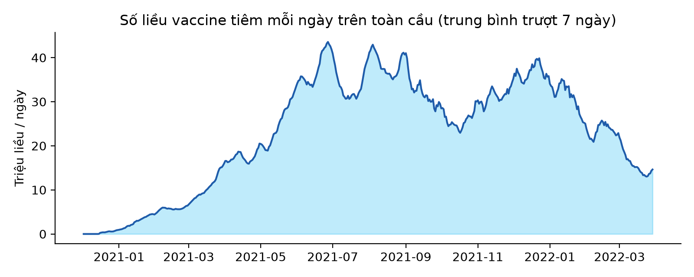
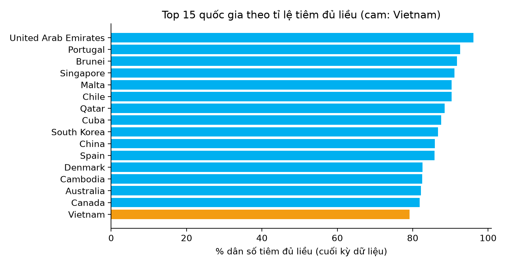
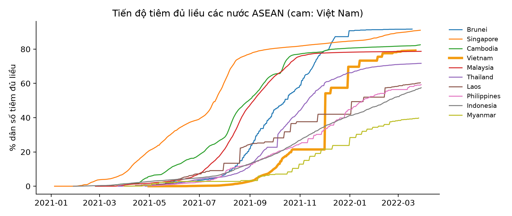
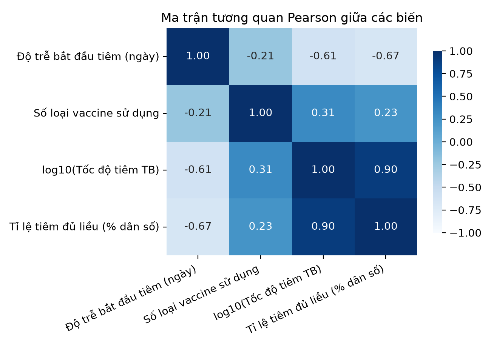
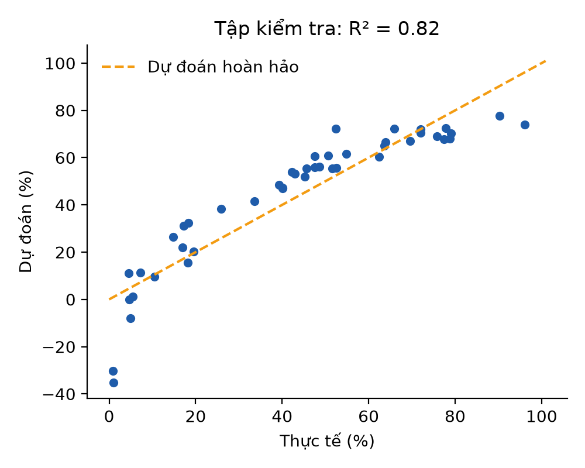
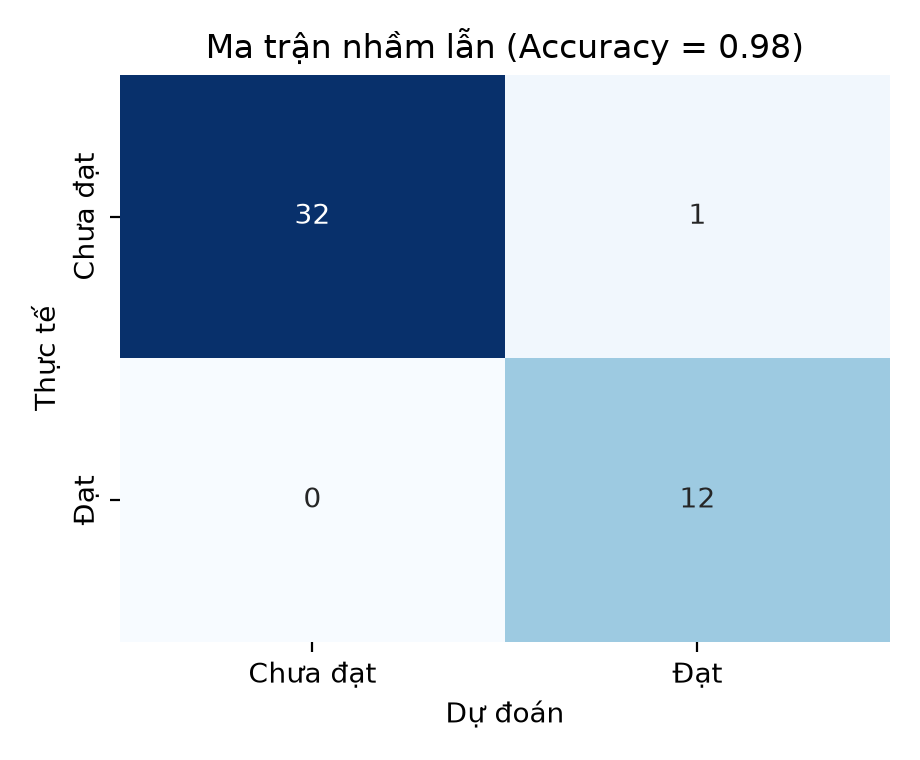

# Tiến độ tiêm chủng COVID-19 và các yếu tố liên quan
Mini-project AI + Python: phân tích dữ liệu và sinh báo cáo tự động
Lê Thị Mỹ Nhân (MSHV: M2526010) – Học phần Công nghệ số nâng cao (CT999), Đại học Cần Thơ

## Dữ liệu và cách làm
- Nguồn: Kaggle – COVID-19 World Vaccination Progress (Gabriel Preda), CC0; dữ liệu gốc Our World in Data
- 84.056 dòng sau làm sạch, 02/12/2020 – 29/03/2022; 179 quốc gia có từ 100.000 người đã tiêm
- Làm sạch: pandas, numpy · Biểu đồ: matplotlib, seaborn · Mô hình: scikit-learn
- Tự động sinh báo cáo PDF (fpdf2), slide (python-pptx) và dashboard (Streamlit)

## Xu hướng tiêm toàn cầu

- Đỉnh 43.6 triệu liều/ngày vào 27/06/2021
- Sau đỉnh, tốc độ tiêm giảm dần

## Các quốc gia dẫn đầu

- Cao nhất: United Arab Emirates 96.1%, Portugal 92.6%, Brunei 91.7%
- Trung vị 179 quốc gia: 52.5%
- 26% quốc gia đạt mốc 70%

## Việt Nam trong ASEAN

- Việt Nam: 79.2%, thứ 4/10 ASEAN
- Bắt đầu trễ 94 ngày so với quốc gia đầu tiên
- Vaccine phổ biến: Oxford/AstraZeneca (177 quốc gia), Pfizer/BioNTech (152 quốc gia), Sinopharm/Beijing (90 quốc gia)

## Tương quan giữa các biến

- Độ trễ bắt đầu tiêm (ngày): r = -0.67
- Số loại vaccine sử dụng: r = 0.23
- log10(Tốc độ tiêm TB): r = 0.9
- Kết luận: tốc độ tiêm liên hệ mạnh nhất

## Mô hình hồi quy tuyến tính

- R² kiểm tra: 0.82 · MAE: 8.8 điểm %
- Tốc độ tiêm tăng 10 lần: tỉ lệ tiêm đủ liều cao hơn 49.2 điểm %
- Mỗi ngày bắt đầu muộn: -0.116 điểm %

## Mô hình phân loại (cây quyết định)

- Dự đoán quốc gia đạt mốc 70% tiêm đủ liều
- Accuracy: 0.98 · F1: 0.96
- Biến quan trọng nhất: log10(Tốc độ tiêm TB)

## Kết luận và đề xuất
- Năng lực tiêm hằng ngày là yếu tố gắn chặt nhất với tỉ lệ tiêm đủ liều
- Bắt đầu sớm giúp tỉ lệ cao hơn; Việt Nam bắt đầu muộn nhưng vượt trung vị
- Hạn chế: ít biến, tập kiểm tra nhỏ; kết quả là tương quan, không phải nhân quả
- Đề xuất: bổ sung biến kinh tế – xã hội, dùng kiểm định chéo

## CÁM ƠN
- Thank you
